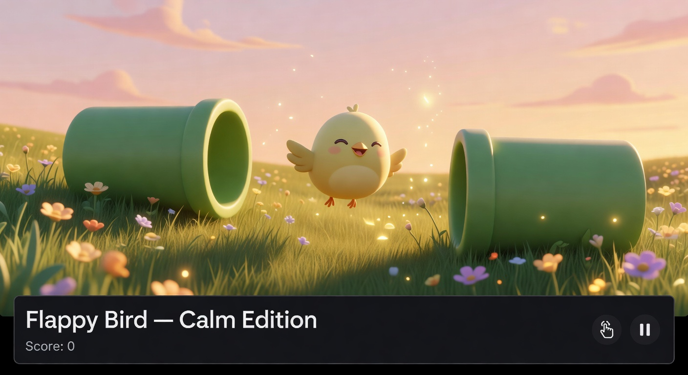

# GlidieBirdie

[](https://github.com/0thernes/glidiebirdie/actions/workflows/ci.yml)
[](https://0thernes.github.io/glidiebirdie/)
[](https://github.com/0thernes/glidiebirdie/actions/workflows/post-deploy-canary.yml)
[](LICENSE.txt)
[](https://www.repostatus.org/#active)

**Status:** Active (`v3.2.0`) · **Build Standard:** `v1.2.0` (`repo.yaml`) · **Epistemic Scope:** Verified browser-game engineering build (not peer reviewed; retires `0 / 1,900` open problems in `0thernes/unsolved-problems-mega-atlas`).

A browser-first, one-tap arcade flyer tuned for comfort instead of punishment.

GlidieBirdie keeps the fast arcade loop, then softens the failure edges: slower pacing, gentler
physics, readable visuals, full mobile controls, procedural audio with reverb, a forgiving Feather
Shield, daily seeded runs, five living themes, 12 achievements, a Serene Postcard capture mode, and a
small offline-ready PWA shell. No build step, no runtime dependency, no remote asset requirement.
Serve it from any static host and glide.

[](https://0thernes.github.io/glidiebirdie/)

[Play the live demo](https://0thernes.github.io/glidiebirdie/) ·
[Build White Paper (PDF)](dist/Donahue_2026_glidiebirdie_deterministic_browser_architecture.pdf) ·
[Lean 4 Blueprint](blueprint/index.html) ·
[Claims Ledger](CLAIMS.md) ·
[Limitations](LIMITATIONS.md) ·
[Replication](REPLICATION.md) ·
[Contributing](CONTRIBUTING.md) ·
[Support](SUPPORT.md)

## Why It Feels Better

| Design goal | What GlidieBirdie does |
| --- | --- |
| Softer difficulty | Larger pipe gaps, slower travel, gentler gravity, slower terminal fall, circle hitbox. |
| Full mobile depth | On-screen Brake / Flap / Dive buttons on phones — full keyboard depth, no controls hidden. |
| More player expression | Hold Brake (or `Shift`), hold Dive (or `↓`), and tune physics in the Zen Customizer. |
| More delight | Meadow golden godrays + drifting pollen, five themes, reverb, ambient music, particle bursts, expressive bird emotions, cozy achievements, and Serene Postcard mode for shareable moments. |
| Less punishment | Feather Shield absorbs one collision and gives the bird a graceful recovery moment. |
| Better reliability | Fixed 60 Hz simulation with interpolation, so 60 Hz and 144 Hz displays share one trajectory. DPR-sharp canvas on Retina and 4K. |
| Better inclusion | Keyboard + skip-link, ARIA live updates, reduced-motion, reduced-transparency, forced-colors. |
| PWA-ready | Installable via Add-to-Home-Screen on iOS and Android. Offline app shell after first visit. |

## The Calm Philosophy

We kept the addictive loop everyone loves and removed everything that hurts. Larger gaps. Gentler
gravity. A shield that forgives. Five living themes you can feel in your chest. Procedural sound that
breathes with the world. A bird with real emotions and eyes that look for safety. No accounts. No ads.
No build step.

This is what happens when you treat "calm" as a design material, not a marketing word. It is a small,
solo, vibe-coded act of care: one HTML file, one CSS file, native ES modules in `src/`, zero runtime
dependencies, and a deep commitment to accessibility and reduced-motion respect.

## Features

- **Mobile control bar** — On-screen Brake / Flap / Dive on coarse-pointer devices.
- **PWA install + offline shell** — Add to Home Screen on iOS and Android via a real manifest and service worker.
- **DPR-sharp canvas** — Crisp on Retina, 2× / 3× phones, and 4K monitors.
- **Calm physics presets** — Tune gravity and speed from gentle to lively.
- **Daily Seed mode** — Deterministic pipe pattern by UTC date for friendly comparison.
- **Zen Customizer** — Physics sliders, audio volumes, theme picker, daily-seed toggle, FPS toggle, audio test, reset stats.
- **Five themes** — Sunset, Midnight, Cozy Rain, Aurora, and Meadow (golden-hour greens & warm sunlight), each changing colors, weather, and music.
- **Feather Shield** — A collectible bubble that absorbs one crash and grants brief invincibility.
- **Serene Postcard mode** — Pause into a calm frame and save a shareable PNG (`P` to enter, `C` to capture).
- **Expressive bird** — Calm, happy, scared, determined, and dizzy states with blush, smile, crest, and dizzy swirls.
- **Eye tracking** — Pupils track the nearest safe gap for a lively, readable character.
- **Procedural audio with reverb** — Web Audio creates every tone; convolution reverb gives real ambient space.
- **12 achievements** — From First Flight to Long Haul, each with live progress display.
- **Persistent stats** — Zen minutes, shields saved, runs, near misses, longest survival, current streak.
- **Tutorial overlay** — Shown once on first run; the dismiss button starts the first glide.
- **Fullscreen toggle** — `F` key or button.
- **Zero dependencies** — Pure HTML, CSS, and JavaScript. No bundler, package install, CDN, or assets.

## Quick Start

### Open the game

Because the engine loads native ES modules (`<script type="module">`), browsers require HTTP(S) rather than `file://`. Start a tiny local static server:

```bash
node tools/static-server.mjs 8000
```

(Or `python -m http.server 8000` if you prefer Python.) Then visit `http://127.0.0.1:8000`.

### Run the checks

```bash
npm run check
```

That command needs no install. It syntax-checks every module, then runs static checks, brand/link/license guards, the engine tests (they import `src/`), the 60 Hz / 144 Hz determinism test, and the repo smoke test.

Lint, Playwright, and axe need the dev dependencies:

```bash
npm ci
npm run lint
npm run test:browser
```

A separate `npm run typecheck` runs ephemeral TypeScript over the `checkJs`-clean engine.

## Usage & Examples

### Run the deterministic simulation example

```bash
node examples/determinism_demo.mjs
```

### Run fuzzing, mutation testing, benchmarks, and Build Standard self-audit

```bash
npm run fuzz        # 2,000 adversarial parser & HTTP static-server fuzz cases
npm run mutate      # baseline-gated 12/12 surgical mutants killed (100.0%)
npm run benchmark   # 30 counterbalanced paired seeds + 5,400 pure steps -> results/benchmarks.json
npm run audit       # Build Standard v1.2.0 audit via scripts/Audit-Repo.ps1
```

### Formal Verification — Exact Lean 4.35.0 Axiom Audit (5-Second Proof)

All **55 theorems** in [`lean/`](lean/README.md) (47 core + 8 constructive adversarial refutations) compile with zero Mathlib, zero `sorryAx`, zero `native_decide`, and zero custom axioms (`cd lean && lake build && lake build Challenge && lake env lean VerifyAxioms.lean && lake env leanchecker-paranoid --fresh Solution`). Headline outputs from `VerifyAxioms.lean`:

```text
'GlidieBirdie.Timestep.lcm_60_144_eq_720' does not depend on any axioms
'GlidieBirdie.Timestep.steps_executed_no_drop_under_60_ticks' depends on axioms: [propext, Quot.sound]
'GlidieBirdie.Collision.distSqPointRect_minimality' depends on axioms: [propext, Quot.sound]
'GlidieBirdie.Collision.circleHitsRect_monotone_radius' depends on axioms: [propext, Quot.sound]
'GlidieBirdie.Storage.dateSeedNat_injective' depends on axioms: [propext, Classical.choice, Quot.sound]
'GlidieBirdie.Pools.poolClearAll_conserves_and_empties' depends on axioms: [propext, Quot.sound]
'GlidieBirdie.Pools.queuePushMany_bounded' depends on axioms: [propext, Quot.sound]
'GlidieBirdie.Physics.mulberry32_golden_20261125' depends on axioms: [propext, Quot.sound]
'GlidieBirdie.Adversarial.adversarial_unguarded_neg_radius_false_hit' does not depend on any axioms
```

See the [Build White Paper](dist/Donahue_2026_glidiebirdie_deterministic_browser_architecture.pdf), [Interactive Blueprint](blueprint/index.html), [`CLAIMS.md`](CLAIMS.md), [`LIMITATIONS.md`](LIMITATIONS.md), and [`REPLICATION.md`](REPLICATION.md) for the complete statement-fidelity audit, 30-seed benchmarks, and clean-clone instructions.

## Controls

| Input | Action |
| --- | --- |
| `Space` / `Arrow Up` / click / tap | Flap |
| hold `Shift` / on-screen Brake | Slow descent |
| hold `Arrow Down` / on-screen Dive | Controlled dive |
| `Escape` | Pause or resume |
| `M` | Mute or unmute |
| `R` | Restart run |
| `F` | Toggle fullscreen |
| Gamepad Cross / A, or D-pad up | Flap |
| Gamepad LB or left trigger | Brake |
| Gamepad RB, right trigger, or D-pad down | Dive |
| Gamepad Start | Pause |
| Gamepad Back | Mute |
| `P` | Serene Postcard mode (calm capture) |
| `C` | Save the current frame as a PNG |

On phones and tablets, the mobile control bar stays visible near the bottom of the screen so the core
actions never depend on hidden gestures.

## Accessibility

Accessibility is part of the product, not cleanup work after the fact.

- Fully keyboard-playable core loop.
- ARIA live region for score and status updates.
- Focus-managed customizer drawer with inert background handling.
- Reduced-motion support for effects, weather, particles, and shake.
- Stronger borders under `prefers-contrast: more` and `forced-colors`.
- Skip link and semantic landmarks for faster navigation.

## Architecture At A Glance

The project is intentionally small and flat:

- `index.html` is the semantic shell, UI layout, mobile controls, drawer, and PWA metadata.
- `style.css` owns layout, theme tokens, accessibility media queries, and component styling.
- `game.js` is the module entry. `src/` holds physics, collision, input (including gamepad), audio, rendering, storage, and UI.
- `manifest.webmanifest` and `service-worker.js` provide installation and offline shell behavior.
- `tests/` holds dependency-free Node checks wired into `npm run check`, plus Playwright/axe-core E2E tests under `tests/e2e/`.

For the deeper runtime walkthrough, read [docs/architecture_master_blueprint.md](docs/architecture_master_blueprint.md).

## Repository Map

| Path | Purpose |
| --- | --- |
| `index.html` | Semantic shell, canvas, mobile controls, drawer, tutorial, and PWA metadata |
| `style.css` | Layout, theme system, responsive rules, and accessibility styling |
| `game.js` | Module entry. Calls `boot()` from `src/main.js` |
| `src/` | Engine modules served as-is by GitHub Pages |
| `manifest.webmanifest` | Install metadata for PWA flows |
| `service-worker.js` | Minimal offline app-shell cache |
| `tests/static-checks.mjs` | Static guards: duplicate keys/ids, self-comparisons |
| `tests/brand-guard.mjs` | Ensures retired trademarked terms never reappear |
| `tests/link-guard.mjs` | Verifies every local HTML/manifest asset reference resolves |
| `tests/license-guard.mjs` | Enforces MIT license consistency across `LICENSE.txt` and `package.json` |
| `tests/engine-test.mjs` | 69 headless engine behavioral tests importing `src/` |
| `tests/property-and-metamorphic.mjs` | 8 property-based, metamorphic, failure-injection, differential & HTTP contract suites (2,500+ trials) |
| `tests/determinism.mjs` | Verifies 180 identical 60 Hz and 144 Hz steps on the 720 Hz fixed tick grid |
| `tests/smoke-test.mjs` | Syntax and surface-area smoke checks |
| `tests/e2e/smoke.spec.js` | 7 Playwright browser tests + 4-view WCAG 2.2 AA axe-core checks |
| `tests/fuzz-http-and-inputs.mjs` | 2,000-case structured adversarial parser & HTTP static-server fuzzer (`B15`) |
| `lean/` | 55 pure Lean 4.35.0 formal theorems (zero Mathlib, Palomar `Challenge`/`Solution`, 6-kernel comparator + negative tamper test) |
| `paper/` & `dist/` | Zero-warning AMS-LaTeX Build White Paper PDF and clean-room `arxiv_submission.tar.gz` |
| `blueprint/index.html` | Interactive Lean 4 Proof Blueprint & Claims Dependency Map |
| `scripts/` | Baseline-gated 12-mutant harness (`mutation-test.mjs`), 30-seed counterbalanced benchmarks (`benchmark.mjs`), citation verifier (`check-citations.mjs`), Build Standard v1.2.0 audit scripts |
| `examples/` | Runnable zero-dependency example (`determinism_demo.mjs`) |
| `tools/` | Zero-dependency dev helpers (`static-server.mjs`, `generate-icons.mjs`) |
| `VERSION`, `repo.yaml`, `justfile` | Single version source (`3.2.0`), Build Standard v1.2.0 manifest, one-word task runner |
| `CLAIMS.md`, `LIMITATIONS.md`, `REPLICATION.md` | Falsifiable claims ledger, honest epistemic scope (`0/1,900` Mega-Atlas), clean-clone replication |
| `CITATION.cff`, `CITATION.bib`, `.zenodo.json` | Machine-readable scholarly citation & archival metadata |
| `CHECKSUMS.sha256`, `data/MANIFEST.sha256` | Deterministic SHA-256 checksums for browser shell, benchmarks, PDF, and arXiv tarball |
| `RELEASING.md`, `UPGRADING.md` | Release checklist and version upgrade guide |
| `docs/architecture_master_blueprint.md` | Calm, humble philosophy & technical architecture reference |
| `docs/ARCHITECTURE.md` | System + engine architecture with diagrams (frame loop, rendering, audio, boot, invariants) |
| `docs/adr/` | Architecture Decision Records (`0001`–`0003`) |
| `docs/benchmarks.md`, `docs/preregistration.md` | 30-seed paired benchmarks & pre-registered hypotheses |
| `docs/threat-model.md`, `docs/operations.md` | Security boundary analysis, `/healthz`, backups, offsite mirror, and rollback |
| `docs/configuration.md`, `docs/faq.md`, `docs/glossary.md` | Environment variables, FAQ, and canonical glossary |
| `docs/run-log.md`, `docs/reviews/` | Chronological hardening audit trail and 10-class red-team review register |
| `docs/DATA-MODEL.md` | ERM/ERD of the `gb:` storage layer, key schema, and legacy→`gb:` migration |
| `docs/COMPLEXITY.md` | Time/space (Big-O) of every subsystem + the shipped DSA upgrades |
| `docs/INSPECTION-500.md` | 500-point inspection (25 sections × 20), scored |
| `docs/ROADMAP.md` | Kanban board (Done / Next / Backlog), cadence, definition of done |
| `docs/README.md` | Documentation index |
| `docs/assets/`, `docs/media/` | Cinematic hero and OpenGraph social preview images |
| `AUDIT-250.md` | Canonical 250-point quality audit ledger |
| `CHANGELOG.md` | Version history |
| `AGENTS.md`, `CLAUDE.md`, `GEMINI.md`, `llms.txt` | Canonical AI-assistant guidance (`CLAUDE.md`/`GEMINI.md` point to `AGENTS.md`) & LLM context bundles |
| `CODE_OF_CONDUCT.md`, `CONTRIBUTING.md`, `SUPPORT.md` | Community guidelines, contributor workflow, and troubleshooting |
| `THIRD_PARTY_NOTICES.md`, `NOTICE`, `LICENSE.txt` | MIT license, CC BY 4.0 white-paper terms, and third-party dev-tool attributions |
| `.github/` | Cross-platform CI, 6-kernel Lean CI, Tectonic paper CI, Pages deploy, release workflow, `SECURITY.md`, issue forms, and finding-class labels |
| `.memory/` | Project notes for future maintainers and assistant sessions |

## New Here? Read In This Order

1. `README.md` — the product and workflow overview.
2. `docs/architecture_master_blueprint.md` — the runtime layout.
3. `CONTRIBUTING.md` — change boundaries and review expectations.
4. `AGENTS.md` / `CLAUDE.md` — AI-assistant guardrails and the protected merge flow.

## Browser Support

- Chrome and Edge 105+
- Firefox 128+
- Safari 16.4+
- Samsung Internet 21+
- Current iOS Safari and Android Chrome

## Contributing

Contributions are welcome when they keep the game calm, accessible, dependency-free, and easy to run.
Start with [CONTRIBUTING.md](CONTRIBUTING.md) and our [Code of Conduct](CODE_OF_CONDUCT.md), then use the
issue templates for bugs, feature ideas, or accessibility feedback.

Small, focused changes are preferred. Keep the project dependency-free, browser-first, and calm by default.

## Support

If the game does not run as expected, start with [SUPPORT.md](SUPPORT.md).

## License

MIT. See [LICENSE.txt](LICENSE.txt).

Use it, fork it, remix it, ship it — a short attribution notice is all that's asked.
